# Class Activity 1 — System Calls in Practice

- **Student Name:** Bora Picheth
- **Student ID:** e20231011
- **Date:** 24/10/2026

---

## Warm-Up: Hello System Call

Screenshot of running `hello_syscall.c` on Linux:

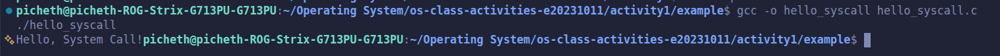

Screenshot of running `hello_winapi.c` on Windows (CMD/PowerShell/VS Code):

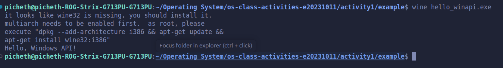

Screenshot of running `copyfilesyscall.c` on Linux:

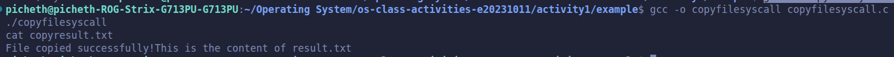

---

## Task 1: File Creator & Reader

### Part A — File Creator

**Describe your implementation:** The C library version (`file_creator_lib.c`) uses `<stdio.h>` functions (`fopen`, `fprintf`/`fputs`, `fclose`) which operate on a high-level `FILE *` stream pointer, handle string formatting automatically, and buffer output in user space before flushing to the kernel. The POSIX system call version (`file_creator_sys.c`) uses `<fcntl.h>` and `<unistd.h>` (`open`, `write`, `close`), operating directly on an integer file descriptor (`fd`) and requiring manual byte-length calculation (`strlen`) and explicit file permission bitmasks (`0644`).

**Version A — Library Functions (`file_creator_lib.c`):**

<!-- Screenshot: gcc -o file_creator_lib file_creator_lib.c && ./file_creator_lib && cat output.txt -->
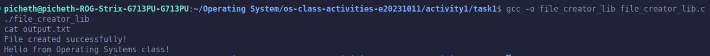

**Version B — POSIX System Calls (`file_creator_sys.c`):**

<!-- Screenshot: gcc -o file_creator_sys file_creator_sys.c && ./file_creator_sys && cat output.txt -->
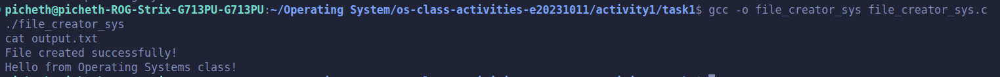

**Questions:**

1. **What flags did you pass to `open()`? What does each flag mean?**

   > I passed `O_WRONLY | O_CREAT | O_TRUNC`:
   > - **`O_WRONLY`**: Opens the file in write-only mode.
   > - **`O_CREAT`**: Tells the kernel to create the file if it does not already exist.
   > - **`O_TRUNC`**: If the file already exists and is a regular file, it truncates its length to 0 bytes (overwriting existing contents).

2. **What is `0644`? What does each digit represent?**

   > `0644` is an octal permission mode passed to `open()` when creating a new file (`O_CREAT`):
   > - **`0` (Prefix)**: Indicates the number is written in base-8 (octal) notation in C.
   > - **`6` (Owner/User = `110` in binary = `rw-`)**: Read (4) + Write (2) permissions for the file owner.
   > - **`4` (Group = `100` in binary = `r--`)**: Read-only (4) permission for members of the file's group.
   > - **`4` (Others = `100` in binary = `r--`)**: Read-only (4) permission for all other users on the system.

3. **What does `fopen("output.txt", "w")` do internally that you had to do manually?**

   > Internally, `fopen("output.txt", "w")` translates the `"w"` mode string into the bitmask `O_WRONLY | O_CREAT | O_TRUNC`, supplies default creation permissions (`0666`, which is then modified by the process's `umask`), invokes the `openat()` system call, and allocates and initializes a `FILE` structure on the heap (via `brk`/`malloc`) with an internal user-space I/O buffer. In the system call version, I had to specify the bitmask flags, permission mode (`0644`), and buffer sizes manually.

### Part B — File Reader & Display

**Describe your implementation:** The library version (`file_reader_lib.c`) opens `output.txt` with `fopen("output.txt", "r")` and reads content using `fgets()` or `fread()`, which automatically buffers up to 4096 bytes at a time in user space and appends a null terminator (`\0`) for easy printing. The system call version (`file_reader_sys.c`) uses `open("output.txt", O_RDONLY)` and loops over `read(fd, buffer, sizeof(buffer))` (requesting 256 bytes at a time), writing the exact number of bytes returned directly to standard output (`fd = 1`) using `write(1, buffer, bytes_read)`.

**Version A — Library Functions (`file_reader_lib.c`):**

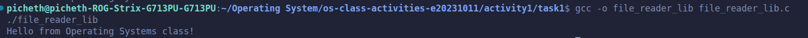

**Version B — POSIX System Calls (`file_reader_sys.c`):**

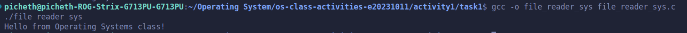

**Questions:**

1. **What does `read()` return? How is this different from `fgets()`?**

   > `read()` returns a `ssize_t` integer representing the exact number of raw bytes read into the buffer (e.g., `36`), `0` when it reaches End-of-File (EOF), or `-1` on error. Importantly, `read()` does **not** null-terminate the buffer. In contrast, `fgets()` returns a `char *` pointer to the buffer on success or `NULL` on EOF/error, stops reading at a newline (`\n`), and automatically appends a null byte (`\0`) to create a valid C string.

2. **Why do you need a loop when using `read()`? When does it stop?**

   > A loop is necessary because a single `read()` call is only guaranteed to read up to the size of your buffer (e.g., 256 bytes), or even fewer bytes if reading from pipes, sockets, or large files that exceed the buffer size. The loop continues calling `read()` to process chunks sequentially and stops when `read()` returns `0` (indicating the file offset has reached the End-of-File) or `-1` (indicating an error).

---

## Task 2: Directory Listing & File Info

**Describe your implementation:** Both versions iterate through the current directory (`.`) and inspect each file's metadata using `stat()`. The library version (`dir_list_lib.c`) uses `printf()` to format and display the file names and sizes directly to the terminal. The system call version (`dir_list_sys.c`) avoids `printf()` and instead formats the string into a character buffer using `snprintf()` before sending the raw bytes to standard output (`STDOUT_FILENO`) via the `write()` system call.

### Version A — Library Functions (`dir_list_lib.c`)

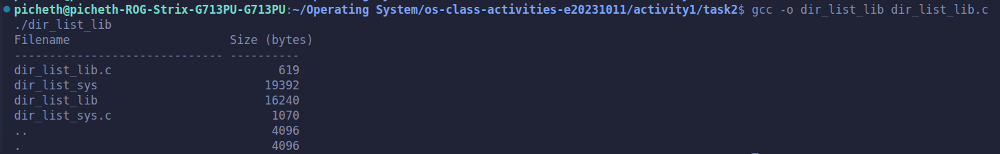

### Version B — System Calls (`dir_list_sys.c`)

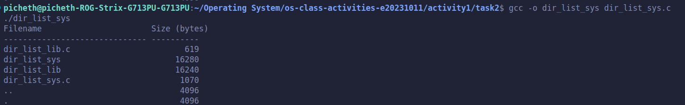

### Questions

1. **What struct does `readdir()` return? What fields does it contain?**

   > `readdir()` returns a pointer to a `struct dirent` (`struct dirent *`). On Linux, its fields are:
   > - **`d_ino`**: The inode number of the file.
   > - **`d_off`**: The filesystem-specific offset to the next `dirent` structure.
   > - **`d_reclen`**: The length (in bytes) of this directory record.
   > - **`d_type`**: The type of the file (e.g., regular file `DT_REG`, directory `DT_DIR`, symlink `DT_LNK`).
   > - **`d_name`**: A null-terminated character array (`char d_name[256]`) holding the filename.

2. **What information does `stat()` provide beyond file size?**

   > Beyond file size (`st_size`), `struct stat` provides:
   > - **`st_mode`**: File type (regular file, directory, symlink, etc.) and access permission bits (`rwx`).
   > - **`st_ino` & `st_dev`**: The inode number and ID of the device containing the file.
   > - **`st_nlink`**: Number of hard links pointing to the file.
   > - **`st_uid` & `st_gid`**: User ID and Group ID of the file's owner.
   > - **`st_blksize` & `st_blocks`**: Preferred I/O block size and number of 512-byte blocks allocated.
   > - **`st_atime`, `st_mtime`, `st_ctime`**: Timestamps for last access, last content modification, and last status/metadata change.

3. **Why can't you `write()` a number directly — why do you need `snprintf()` first?**

   > `write()` outputs raw bytes from a memory address directly to the terminal; if you pass the memory address of an integer (like `st_size = 36`), the terminal tries to interpret the raw binary value (`0x24 0x00 0x00 0x00...`) as ASCII characters, resulting in unprintable garbage or symbols. `snprintf()` is needed first to convert the binary integer value into human-readable ASCII digit characters (`'3'`, `'6'`) stored in a string buffer before passing that buffer to `write()`.

---

## Optional Bonus: Windows API (`file_creator_win.c`)

Screenshot of running on Windows:

### Bonus Questions

1. **Why does Windows use `HANDLE` instead of integer file descriptors?**

   > Windows has an object-based kernel where files, processes, threads, mutexes, events, and registry keys are all managed uniformly by the Kernel Object Manager. A `HANDLE` (`void *`) is an opaque, type-safe index into a process's kernel handle table that can reference any kernel object (not just I/O streams) and enforces Windows security descriptors and access control lists (ACLs) uniformly.

2. **What is the Windows equivalent of POSIX `fork()`? Why is it different?**

   > The Windows equivalent for starting a new process is `CreateProcess()` (`CreateProcessA` / `CreateProcessW`). While POSIX `fork()` clones the current calling process into an identical child process (using copy-on-write memory pages) before calling `execve()` to load a new binary, `CreateProcess()` combines process creation and executable loading into a single step from scratch—allocating a new address space and loading the specified `.exe` directly without cloning the parent's memory.

3. **Can you use POSIX calls on Windows?**

   > Yes, in two ways: Microsoft's C Runtime Library (UCRT) provides POSIX-like wrapper functions prefixed with an underscore (such as `_open()`, `_read()`, `_write()`, `_close()` in `<io.h>`) that translate calls into Win32 API calls (`CreateFile`, `ReadFile`, `WriteFile`) under the hood. Alternatively, compatibility layers like WSL (Windows Subsystem for Linux), Cygwin, or MSYS2 provide full POSIX environments on Windows.

---

## Task 3: strace Analysis

**Describe what you observed:** I was surprised that even a tiny 10-line C program triggers over 30 system calls before `main()` even finishes, because the dynamic linker (`ld-linux.so`) has to open `/etc/ld.so.cache` and load `libc.so.6` into memory using `openat`, `mmap`, `fstat`, and `mprotect`. Comparing the two versions, the C library version made **38 total system calls** while the direct system call version made **33 total system calls**—meaning the library version made **5 extra system calls** to set up internal buffering and dynamic heap memory. Also, in the File Reader trace, the library version requested **4096 bytes** in its `read()` call, whereas the system call version requested the exact **256 bytes** written in the C code.

### strace Output — Library Version (File Creator)

<!-- Screenshot: strace -e trace=openat,read,write,close ./file_creator_lib -->
<!-- IMPORTANT: Highlight/annotate the key system calls in your screenshot -->
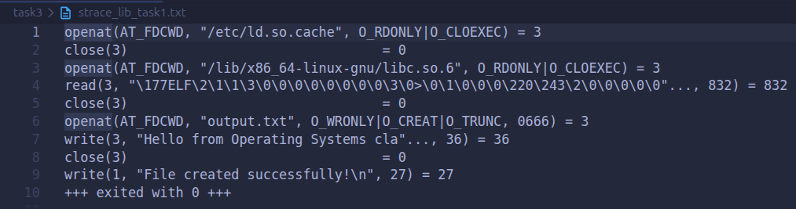

### strace Output — System Call Version (File Creator)

<!-- Screenshot: strace -e trace=openat,read,write,close ./file_creator_sys -->
<!-- IMPORTANT: Highlight/annotate the key system calls in your screenshot -->
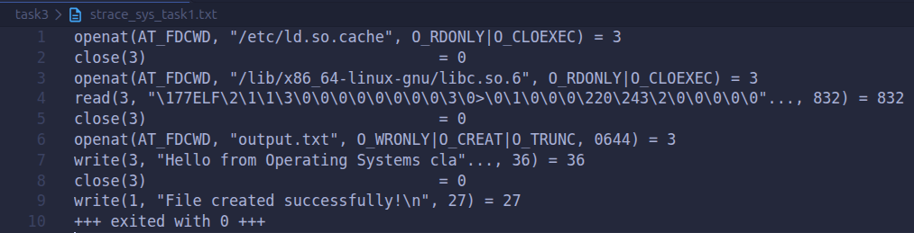

### strace Output — Library Version (File Reader or Dir Listing)

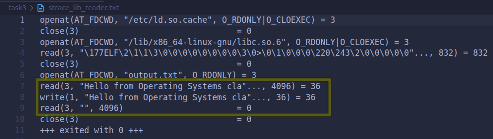

### strace Output — System Call Version (File Reader or Dir Listing)

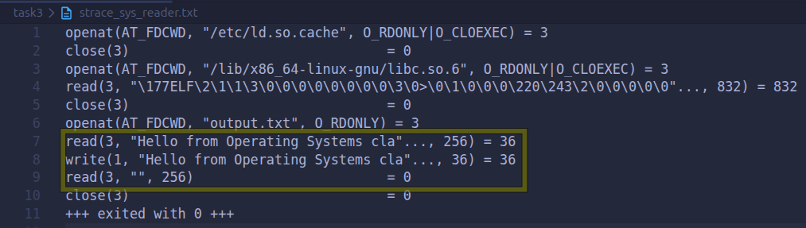

### strace -c Summary Comparison

<!-- Screenshot of `strace -c` output for both versions -->
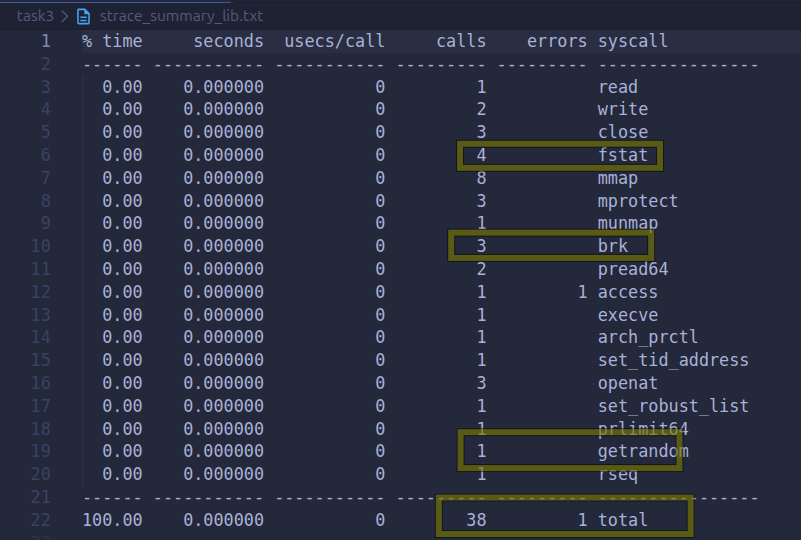

### Questions

1. **How many system calls does the library version make compared to the system call version?**

   > Based on the `strace -c` summary outputs, the library version makes **38 total system calls**, whereas the system call version makes **33 total system calls** (a difference of **5 extra system calls** in the library version).

2. **What extra system calls appear in the library version? What do they do?**

   > Comparing `strace_summary_lib.png` (38 calls) and `strace_summary_sys.png` (33 calls), the 5 extra calls are:
   > - **`fstat` (4 calls in Library vs. 2 calls in Syscall = +2 extra calls)**: `stdio` (`fopen`/`printf`) queries the file status and optimal filesystem block size (4096 bytes) of the file descriptor (`fd 3`) and standard output (`fd 1`) to configure its internal stream buffering.
   > - **`brk` (3 calls in Library vs. 1 call in Syscall = +2 extra calls)**: Expands the process's data segment (heap) so `glibc` can dynamically `malloc()` memory for the `FILE` struct and its 4096-byte internal I/O buffers.
   > - **`getrandom` (1 call in Library vs. 0 calls in Syscall = +1 extra call)**: Called by `glibc` during heap initialization (`malloc`) to generate a random cryptographic seed for heap pointer protection (tcache/safe-linking).

3. **How many `write()` calls does `fprintf()` actually produce?**

   > In our program, `fprintf()` (along with `printf()` for the confirmation message) produced **1 `write()` call per stream** (1 `write(3, ..., 36)` to `output.txt` and 1 `write(1, ..., 27)` to stdout, totaling **2 `write()` calls** in `strace -c`). However, if a program calls `fprintf()` dozens of times with small strings, `stdio` buffers all of them in a 4096-byte user-space buffer and only invokes a single `write()` system call when the buffer fills up, `fflush()` is called, or `fclose()` closes the file.

4. **In your own words, what is the real difference between a library function and a system call?**

   > A **library function** (like `fopen` or `printf`) is normal user-space code provided by the standard C library (`libc.so.6`) that offers programmer-friendly features like string formatting, portability, and memory buffering without leaving user mode unless necessary. A **system call** (like `openat` or `write`) is a direct entry point into the OS kernel triggered by a CPU software interrupt/trap (`syscall` instruction), which switches the CPU from unprivileged user mode to privileged kernel mode so the OS can safely interact with physical hardware.

---

## Task 4: Exploring OS Structure

### System Information

> 📸 Screenshot of `uname -a`, `/proc/cpuinfo`, `/proc/meminfo`, `/proc/version`, `/proc/uptime`:

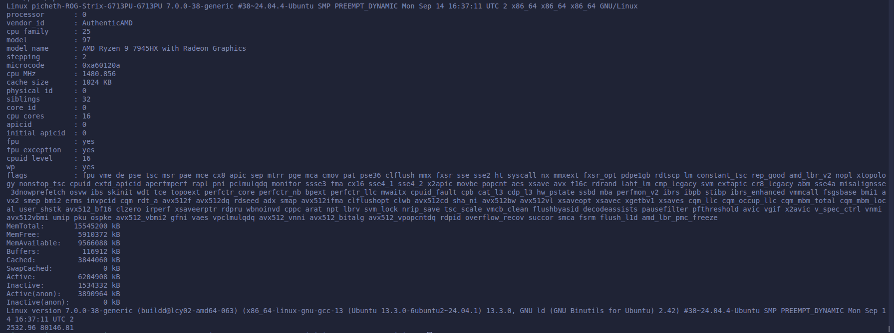

### Process Information

> 📸 Screenshot of `/proc/self/status`, `/proc/self/maps`, `ps aux`:

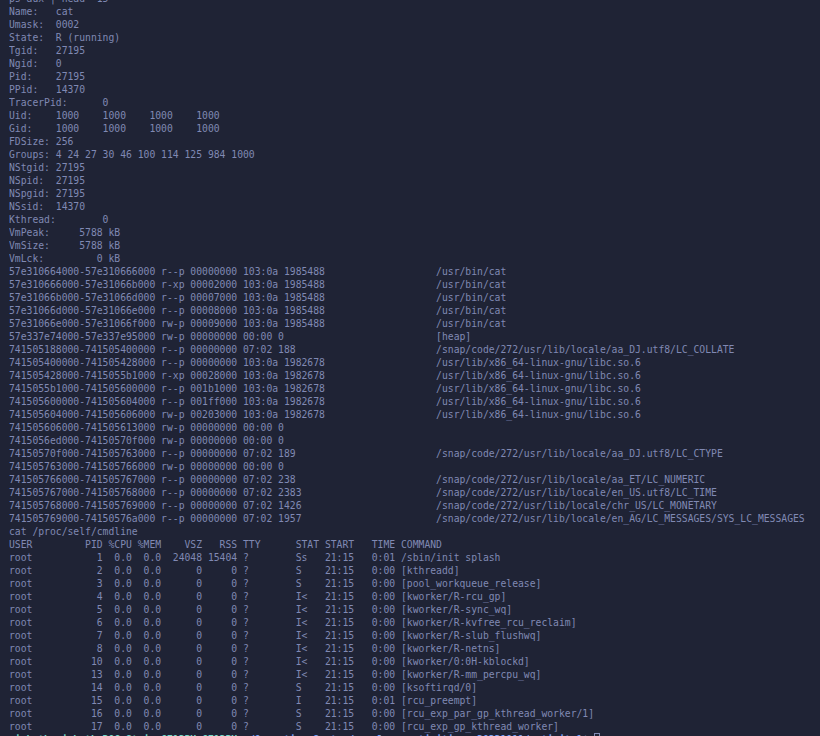

### Kernel Modules

> 📸 Screenshot of `lsmod` and `modinfo`:

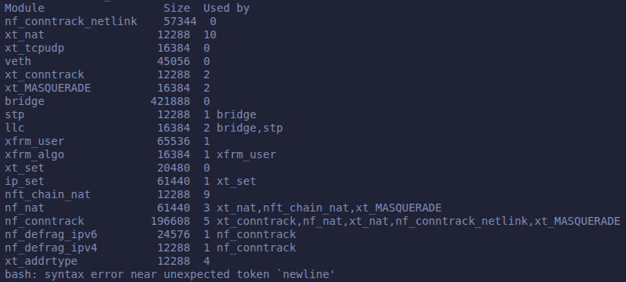

### OS Layers Diagram

> 📸 Your diagram of the OS layers, labeled with real data from your system:

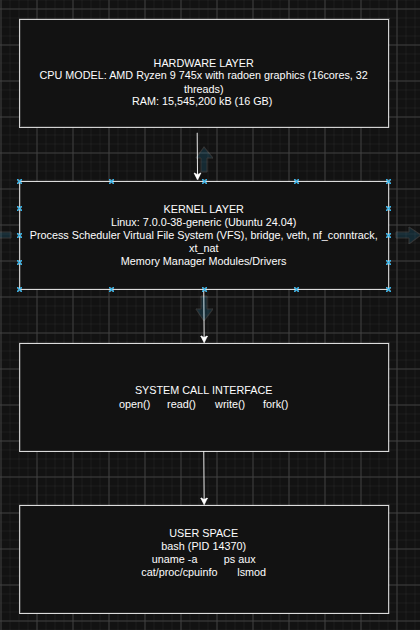

### Questions

1. **What is `/proc`? Is it a real filesystem on disk?**

   > No, `/proc` (`procfs`) is **not** a real filesystem stored on the hard drive or SSD; it takes up 0 bytes of disk space. It is a **virtual (pseudo) filesystem** dynamically generated in RAM by the Linux kernel. When a program reads a file like `/proc/cpuinfo` or `/proc/self/status`, the kernel intercepts the `read()` call and generates the text on the fly directly from live kernel data structures.

2. **Monolithic kernel vs. microkernel — which type does Linux use?**

   > Linux uses a **modular monolithic kernel**. It is **monolithic** because core OS subsystems—process scheduling, memory management, virtual file systems (VFS), networking stacks, and device drivers—all run together in a single shared kernel address space for high performance (avoiding inter-process communication overhead). However, it is also **modular** because functionality (like the `nf_conntrack`, `bridge`, `veth`, and `xt_nat` modules seen in my `lsmod` output) can be dynamically loaded and unloaded at runtime without rebooting.

3. **What memory regions do you see in `/proc/self/maps`?**

   > In my `/proc/self/maps` output (for the `cat` process), I see the following distinct virtual memory segments and their permissions:
   > - **Executable Binary (`/usr/bin/cat`)**: Mapped in multiple segments including read-only (`r--p` for ELF headers/rodata), executable code/text segment (`r-xp`), and read-write data/BSS segments (`rw-p`).
   > - **The Heap (`[heap]`)**: Marked `rw-p` (read-write, private) at `57e337e74000-57e337e95000`, used for dynamic memory allocation (`brk`/`malloc`).
   > - **Shared C Library (`/usr/lib/x86_64-linux-gnu/libc.so.6`)**: Mapped with read-only (`r--p`), executable code (`r-xp`), and read-write data (`rw-p`) segments.
   > - **Anonymous Memory Mappings**: Regions with `00:00 0` and no file path (`rw-p`), used for internal library buffers and thread-local data.
   > - **Locale Data Files (`/snap/code/272/usr/lib/locale/...`)**: Read-only (`r--p`) memory-mapped locale settings (`LC_COLLATE`, `LC_CTYPE`, `LC_TIME`, etc.).

4. **Break down the kernel version string from `uname -a`.**

   > From my terminal output:
   > `Linux picheth-ROG-Strix-G713PU-G713PU 7.0.0-38-generic #38~24.04.4-Ubuntu SMP PREEMPT_DYNAMIC Mon Sep 14 16:37:11 UTC 2 x86_64 x86_64 x86_64 GNU/Linux`
   > - **`Linux`**: The operating system kernel name.
   > - **`picheth-ROG-Strix-G713PU-G713PU`**: The network hostname of my machine.
   > - **`7.0.0-38-generic`**: The kernel release version (`7` = major, `0` = minor, `0` = patch, `-38` = Ubuntu package build revision, `generic` = standard desktop/server kernel flavor).
   > - **`#38~24.04.4-Ubuntu`**: The kernel build number compiled specifically for Ubuntu 24.04.4 LTS.
   > - **`SMP PREEMPT_DYNAMIC`**: Supports Symmetric Multiprocessing (multi-core CPUs like my 16-core/32-thread AMD Ryzen 9 7945HX) and dynamic kernel preemption.
   > - **`Mon Sep 14 16:37:11 UTC ...`**: The timestamp when this kernel binary was compiled.
   > - **`x86_64 x86_64 x86_64`**: The machine hardware architecture, processor type, and hardware platform (64-bit x86).
   > - **`GNU/Linux`**: The operating system userland + kernel distribution family.

5. **How does `/proc` show that the OS is an intermediary between programs and hardware?**

   > User-space programs like `cat` or `ps` are forbidden from directly querying the AMD Ryzen 9 CPU registers or scanning physical RAM chips (`15545200 kB`). `/proc` demonstrates the OS's role as a safe intermediary by applying the **Unix "everything is a file" abstraction**: the kernel gathers hardware specs (`/proc/cpuinfo`, `/proc/meminfo`) and process states (`/proc/self/status`) in privileged mode and exposes them as standard virtual text files. Any user program can then use ordinary `open()` and `read()` system calls to inspect hardware and system state safely without needing direct hardware privileges.

---

## Reflection

What did you learn from this activity? What was the most surprising difference between library functions and system calls?

> Through this activity, I gained a much deeper understanding of how user-space C programs actually communicate with the Linux kernel and hardware. Before running `strace`, it was easy to think of functions like `fopen()`, `printf()`, and `fgets()` as basic, atomic operations. Inspecting the `strace` logs revealed the hidden machinery underneath: every standard library I/O function is actually a user-space wrapper that manages heap memory (`brk`), checks file block sizes (`fstat`), and translates operations into low-level POSIX system calls (`openat`, `read`, `write`, `close`).
>
> The most surprising difference was seeing **user-space buffering** in action during the File Reader task and `strace -c` comparison. Even though `output.txt` only contained 36 bytes (`"Hello from Operating Systems class!\n"`), the library version (`file_reader_lib`) automatically issued a `read(3, ..., 4096)` system call to grab a full 4 KB block at once, whereas the raw system call version (`file_reader_sys`) requested the exact `256` bytes specified in my buffer. Furthermore, while the library version incurred 5 extra setup system calls (`38` total vs. `33` total in `strace -c` due to `fstat`, `brk`, and `getrandom`), I learned why that small upfront cost is worthwhile: in real-world applications that perform thousands of small reads or writes, `stdio` buffering dramatically reduces expensive CPU context switches between user space and kernel space.