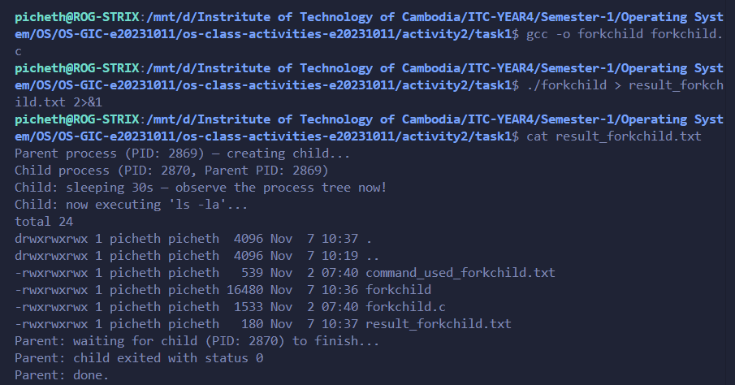
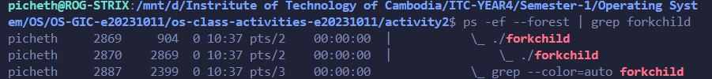
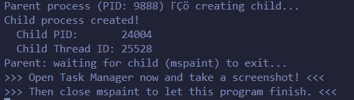
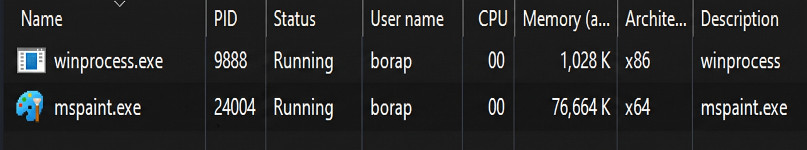
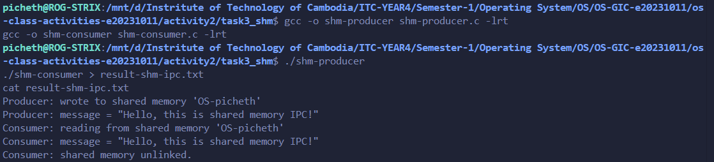
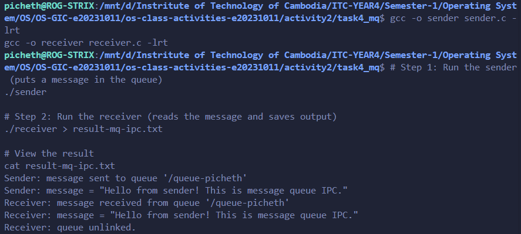

# Class Activity 2 — Processes & Inter-Process Communication

- **Student Name:** Bora Picheth
- **Student ID:** e20231011
- **Date:** 07/11/2026

---

## Task 1: Process Creation on Linux (fork + exec)

### Compilation & Execution

Screenshot of compiling and running `forkchild.c`:

### Process Tree

Screenshot of the parent-child process tree (using `ps --forest`, `pstree`, or `htop` tree view):

### Output

    Parent process (PID: 1234) — creating child...
    Child process (PID: 1235) — executing ls -la
    Parent: child has finished.

### Questions

1. **What does `fork()` return to the parent? What does it return to the child?**

   > To the parent, `fork()` returns the Process ID (PID) of the newly created child process. To the child, `fork()` returns `0`. If it fails, it returns `-1` to the parent.

2. **What happens if you remove the `waitpid()` call? Why might the output look different?**

   > If `waitpid()` is removed, the parent process may terminate before the child finishes execution, leaving the child as an orphan process. The output might look jumbled because the shell prompt could reappear before the child's output is printed to the terminal.

3. **What does `execlp()` do? Why don't we see "execlp failed" when it succeeds?**

   > `execlp()` replaces the current process's memory space and executing program with a completely new program. We don't see "execlp failed" on success because the original code (including the print statement) is entirely overwritten and replaced by the new program; it never returns to the original C code.

4. **Draw the process tree for your program (parent → child). Include PIDs from your output.**

   > bash → forkchild (Parent PID) → ls (Child PID)

5. **Which command did you use to view the process tree (`ps --forest`, `pstree`, or `htop`)? What information does each column show?**

   > I used `ps --forest`. It displays columns such as `USER` (the account running the process), `PID` (Process ID), `PPID` (Parent Process ID), `C` (CPU utilization), `STIME` (start time), `TTY` (terminal type), `TIME` (total CPU time), and `CMD` (the command and its arguments showing the hierarchy).

---

## Task 2: Process Creation on Windows

### Compilation & Execution

Screenshot of compiling and running `winprocess.c`:

### Task Manager Screenshots

Screenshot showing process tree in the **Processes** tab (mspaint nested under your program):

Screenshot showing PID and Parent PID in the **Details** tab:

### Questions

1. **What is the key difference between how Linux creates a process (`fork` + `exec`) and how Windows does it (`CreateProcess`)?**

   > Linux uses a two-step method: `fork()` duplicates the parent process entirely, and `exec()` replaces the duplicate with the new program. Windows uses a single-step method: `CreateProcess()` allocates a fresh memory space and loads the new program directly from scratch without cloning the parent.

2. **What does `WaitForSingleObject()` do? What is its Linux equivalent?**

   > `WaitForSingleObject()` blocks the calling thread (the parent) until the specified object (the child process handle) reaches a signaled state, meaning it has terminated. Its Linux equivalent is `wait()` or `waitpid()`.

3. **Why do we need to call `CloseHandle()` at the end? What happens if we don't?**

   > `CloseHandle()` releases the system resources allocated for the process and thread handles. If not called, a resource leak occurs because the OS must keep the kernel objects in memory even after the process has terminated.

4. **In Task Manager, what was the PID of your parent program and the PID of mspaint? Do they match your program's output?**

   > In my execution, the parent `winprocess.exe` was PID 9888, and the child `mspaint.exe` was PID 24004[cite: 8, 9]. Yes, these matched the `Parent process (PID: 9888)` and `Child PID: 24004` output printed directly by the terminal.

5. **Compare the Processes tab (tree view) and the Details tab (PID/PPID columns). Which view makes it easier to understand the parent-child relationship? Why?**

   > The Details tab makes it easier and more reliable. In Windows 11, the Processes tab often visually detaches modern Store apps (like Paint) into a separate top-level container, breaking the tree view. The Details tab bypasses UI grouping and shows the exact kernel-level `PID` values, proving the relationship irrefutably.

---

## Task 3: Shared Memory IPC

### Compilation & Execution

Screenshot of compiling and running `shm-producer` and `shm-consumer`:

### Output

    Consumer: reading from shared memory 'OS-picheth'
    Consumer: message = "Hello, this is shared memory IPC!"
    Consumer: shared memory unlinked.

### Questions

1. **What does `shm_open()` do? How is it different from `open()`?**

   > `shm_open()` creates or opens a POSIX shared memory object, which resides in RAM (usually mounted at `/dev/shm`) and is optimized for IPC. `open()` is used for traditional file I/O stored on physical disk drives.

2. **What does `mmap()` do? Why is shared memory faster than other IPC methods?**

   > `mmap()` maps a file descriptor directly into the calling process's virtual memory address space. It is faster than other IPC methods because data doesn't have to be copied back and forth between kernel space and user space; processes read and write directly to the same physical RAM block.

3. **Why must the shared memory name match between producer and consumer?**

   > The name acts as the unique identifier (the key) for the operating system to locate the specific shared memory object. If the names don't match, the consumer will try to open a non-existent memory block or read data from an unrelated process.

4. **What does `shm_unlink()` do? What would happen if the consumer didn't call it?**

   > `shm_unlink()` removes the shared memory object name from the system. If it is not called, the shared memory region will persist in the OS memory (consuming RAM) even after both processes have terminated, until the system reboots or it is manually deleted.

5. **If the consumer runs before the producer, what happens? Try it and describe the error.**

   > The consumer fails and exits immediately. Because `shm-consumer.c` opens the shared memory with only `O_RDONLY` (without the `O_CREAT` flag)[cite: 11], it expects the object to already exist. It outputs: `shm_open: No such file or directory`.

---

## Task 4: Message Queue IPC

### Compilation & Execution

Screenshot of compiling and running `sender` and `receiver`:

### Output

    Receiver: message received from queue '/queue-picheth'
    Receiver: message = "Hello from sender! This is message queue IPC."
    Receiver: queue unlinked.

### Questions

1. **How is a message queue different from shared memory? When would you use one over the other?**

   > A message queue passes discrete, structured packets of data sequentially and handles its own synchronization natively. Shared memory is an unstructured block of raw bytes that requires manual synchronization (like mutexes) to prevent race conditions. Use message queues for discrete commands or event passing, and shared memory for transferring massive amounts of data as fast as possible.

2. **Why does the queue name in `common.h` need to start with `/`?**

   > It is a strict requirement of the POSIX IPC standard. POSIX message queues are implemented as a virtual file system, and the leading slash ensures it is treated as a valid, absolute identifier at the root of that virtual namespace.

3. **What does `mq_unlink()` do? What happens if neither the sender nor receiver calls it?**

   > `mq_unlink()` destroys the message queue. If neither process calls it, the queue remains persistent in the OS kernel until the machine reboots, occupying system resources and holding onto any unread messages.

4. **What happens if you run the receiver before the sender?**

   > The receiver will fail to open the queue and exit with `mq_open: No such file or directory`, because the receiver opens the queue as read-only (`O_RDONLY`), while only the sender program includes the `O_CREAT` flag to initialize it.

5. **Can multiple senders send to the same queue? Can multiple receivers read from the same queue?**

   > Yes, multiple senders can push messages to a single queue, and multiple receivers can connect to read from it. However, a single message is typically consumed by only one receiver.

---

## Reflection

What did you learn from this activity? What was the most interesting difference between Linux and Windows process creation? Which IPC method do you prefer and why?

> Through this activity, I gained hands-on experience managing operating system processes and understanding how independent programs communicate. The most interesting difference was seeing how Linux clones a process via `fork()` before overwriting it, whereas Windows uses `CreateProcess()` to build a new application from the ground up, requiring detailed startup configurations and handles. Between the IPC methods, I prefer POSIX Message Queues for standard applications because the OS handles the synchronization and discrete packet structure automatically, avoiding the complexities of race conditions that come with raw Shared Memory.