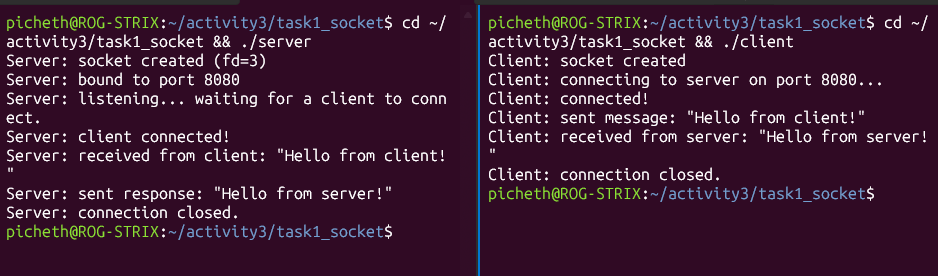
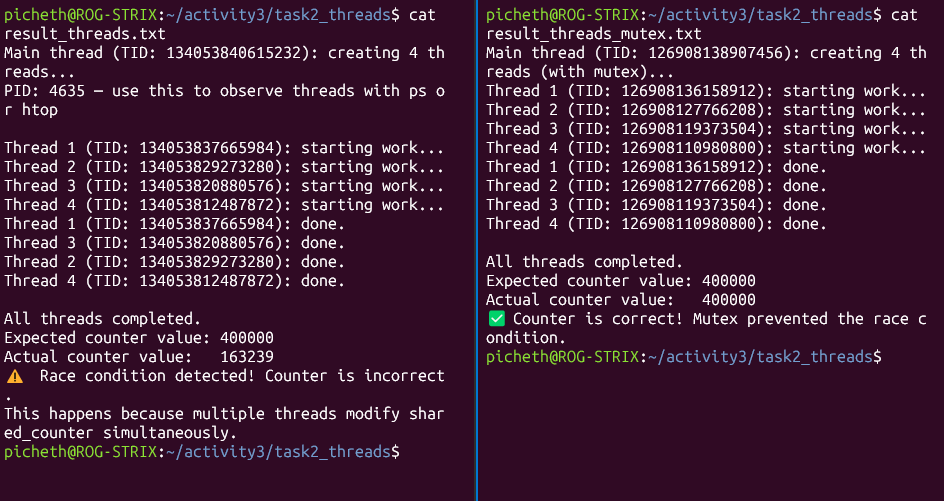
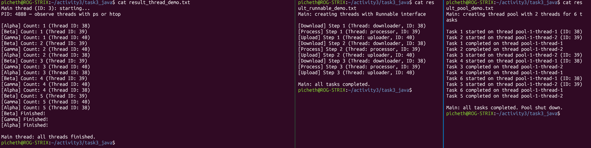

# Class Activity 3 — Socket Communication & Multithreading

- **Student Name:** Bora Picheth
- **Student ID:** e20231011
- **Date:** November 18, 2026

---

## Task 1: TCP Socket Communication (C)

### Compilation & Execution



### Answers

1. **Role of `bind()` / Why client doesn't call it:**
   > `bind()` attaches a specific IP address and local port number to the server's listening socket so clients know the exact endpoint to reach. A client does not call `bind()` because it initiates outbound connections to the server's known IP/port, allowing the OS kernel to automatically assign an available ephemeral (temporary) port during `connect()`.

2. **What `accept()` returns:**
   > `accept()` blocks until a client connects, completes the TCP three-way handshake, and returns a **new socket file descriptor** dedicated to that specific client session. Meanwhile, the original listening socket descriptor remains open to accept additional incoming connections.

3. **Starting client before server:**
   > If the client runs before the server is listening on the target port, the OS rejects the TCP SYN packet with an RST, causing `connect()` to fail immediately with **`Connection refused`** (`ECONNREFUSED`).

4. **What `htons()` does:**
   > `htons()` ("host to network short") converts a 16-bit integer (such as a TCP port number) from host byte order (little-endian on x86/x64) to **network byte order** (big-endian) so systems with different CPU architectures interpret port numbers identically.

5. **Socket call sequence diagram:**
   > ```text
   >        SERVER                                  CLIENT
   >        ------                                  ------
   >       socket()                                socket()
   >          |                                       |
   >        bind()                                    |
   >          |                                       |
   >       listen()                                   |
   >          |                                       |
   >       accept() <--- (TCP 3-Way Handshake) --- connect()
   >          |                                       |
   >        read()  <--------- Request -----------  write()
   >          |                                       |
   >       write()  --------- Response ---------->  read()
   >          |                                       |
   >       close()  <-------- Close / EOF --------  close()
   > ```

---

## Task 2: POSIX Threads (C)

### Output — Without Mutex (Race Condition)



### Output — With Mutex (Correct)

_(Include in the same screenshot or a separate one)_

### Answers

1. **What is a race condition?**
   > A race condition occurs when multiple threads access and modify shared memory concurrently without synchronization, causing the final output to depend on unpredictable thread scheduling. Because incrementing a variable (`counter++`) involves separate read, modify, and write steps, interleaved threads overwrite each other's updates and lose increments.

2. **What does `pthread_mutex_lock()` do?**
   > `pthread_mutex_lock()` enforces mutual exclusion around a critical section. If the mutex is unlocked, the calling thread acquires it and enters; if another thread already holds the lock, the calling thread blocks until `pthread_mutex_unlock()` is called, ensuring only one thread accesses shared data at a time.

3. **Removing `pthread_join()`:**
   > Without `pthread_join()`, the `main` thread does not wait for worker threads to finish. `main` prints the shared counter prematurely (producing an incomplete value) and exits, immediately terminating the entire process and killing all still-running worker threads.

4. **Thread vs Process:**
   > A **process** is an isolated execution unit with its own separate virtual address space, file descriptors, and OS resources, making creation and context switching heavier. A **thread** is a lightweight execution path inside a process that has its own stack, registers, and program counter while sharing the parent process's heap, global variables, and open file descriptors.

---

## Task 3: Java Multithreading

### ThreadDemo Output



### RunnableDemo Output

_(Include output or screenshot)_

### PoolDemo Output

_(Include output or screenshot)_

### Answers

1. **Thread vs Runnable:**
   > Extending `Thread` tightly couples the task logic to the thread object and consumes Java's single class inheritance slot. Implementing `Runnable` separates the unit of work from the execution mechanism, allowing a class to extend another class and letting tasks be submitted to thread pools (`ExecutorService`).

2. **Pool size limiting concurrency:**
   > A fixed thread pool (`Executors.newFixedThreadPool(N)`) caps active worker threads at `N`. Any extra submitted tasks wait in an internal queue until one of the `N` worker threads finishes its current task, preventing unbounded thread creation and CPU/memory exhaustion.

3. **thread.join() in Java:**
   > Calling `t.join()` suspends the calling thread until thread `t` finishes execution (or throws `InterruptedException`), acting as a synchronization barrier so subsequent code runs only after `t` completes.

4. **ExecutorService advantages:**
   > `ExecutorService` reuses existing worker threads instead of paying the overhead of creating and destroying a new OS thread per task, bounds maximum concurrency, simplifies graceful shutdown (`shutdown()` / `awaitTermination()`), and supports returning values or exceptions asynchronously via `Callable` and `Future`.

---

## Task 4: Observing Threads

### Linux — `ps -eLf` Output

```text
UID          PID    PPID     LWP  C NLWP STIME TTY          TIME CMD
picheth     7108    4063    7108  0    5 19:12 pts/1    00:00:00 ./threads_observe
picheth     7108    4063    7110  0    5 19:12 pts/1    00:00:00 ./threads_observe
picheth     7108    4063    7111  0    5 19:12 pts/1    00:00:00 ./threads_observe
picheth     7108    4063    7113  0    5 19:12 pts/1    00:00:00 ./threads_observe
picheth     7108    4063    7114  0    5 19:12 pts/1    00:00:00 ./threads_observe

### Windows — Task Manager


> **Observed Windows Process Details (`ThreadDemo`):**
> - **Image Name:** `java.exe` (OpenJDK Platform binary)[cite: 5]
> - **PID:** `36556`[cite: 5]
> - **Status:** `Running`[cite: 5]
> - **Total Threads:** `25` (4 user threads: `main`, `Alpha`, `Beta`, `Gamma` + 21 internal JVM system threads)[cite: 5]

### Answers

1. **LWP column meaning:**
   > **LWP** stands for **Light Weight Process**, which is the Linux kernel's unique Thread ID (TID) used to schedule each individual thread. All threads in the same multithreaded process share the same `PID` (Thread Group ID) while having their own unique `LWP`.

2. **/proc/PID/task/ count:**
   > `/proc/<PID>/task/` contains **5** directories—one named after the main thread's PID (`7108`) and four named after each worker thread's LWP/TID (`7110`, `7111`, `7113`, `7114`)[cite: 3]—matching the 1 main thread plus 4 `pthread_create()` worker threads.

3. **Extra Java threads:**
   > Although `ThreadDemo` creates only 3 worker threads (`Alpha`, `Beta`, `Gamma`) plus `main` (4 user threads total), Windows Task Manager shows **25 threads** for `java.exe` (PID `36556`)[cite: 5] because the JVM creates internal system threads for Garbage Collection (GC), Just-In-Time (JIT) compilation, Reference Handler, Finalizer, and Signal Dispatcher.

4. **Linux vs Windows thread viewing:**
   > On Linux, every thread is exposed as an individual schedulable entity (`LWP`) visible directly in `htop` (with `H`), `ps -eLf`, and `/proc/<PID>/task/`. On Windows, Task Manager groups all threads under their parent executable (`java.exe`) and displays the aggregate count in the **Threads** column[cite: 5], requiring tools like `jstack` or Process Explorer to inspect individual thread IDs and call stacks.

5. **kthreadd and three kernel threads:**
   > In a standard Linux kernel, **`kthreadd` (PID 2)** is the parent daemon that spawns and manages all kernel-space threads, such as **`ksoftirqd/0`** (handles deferred software interrupts), **`rcu_sched`** (manages Read-Copy-Update synchronization), and **`kworker/...`** (executes asynchronous kernel work queues). *(In WSL2, host kernel threads are hidden from the user-space guest, so PID 2 appears as WSL's `init` process instead[cite: 4].)*

6. **TID equal to PID, NLWP and cores:**
   > The **main thread** has a Thread ID (`LWP`/`TID`) equal to the process `PID` (`7108`)[cite: 3]. **`NLWP`** stands for **Number of Light Weight Processes**, showing **`5`** across all five rows[cite: 3]. The **`CPU` (`PROCESSOR` / `PSR`)** column shows the logical CPU core each thread last ran on (cores `3`, `19`, `20`, `12`, and `22`)[cite: 3], confirming that the OS scheduler distributes threads across multiple hardware cores in parallel.

7. **`H` and `K` in htop:**
   > Pressing **`H`** toggles the visibility of **user-space process threads** (expanding a multithreaded process into individual rows per thread). Pressing **`K`** toggles the visibility of **kernel threads** (system threads running purely in kernel space).

---

## Reflection

> Observing threads directly in `htop`, `/proc/<PID>/task/`, and Windows Task Manager bridged the gap between writing high-level `pthread` / Java code and seeing how the operating system actually schedules concurrent execution. In code, spawning threads feels abstract, but inspecting `LWP` IDs and core assignments (`CPU`/`PSR`) proved that the OS kernel schedules each thread independently across different physical/logical CPU cores at the same time. Seeing multiple cores execute threads simultaneously makes it obvious why unsynchronized shared variables cause race conditions and why protecting critical sections with mutexes and bounding concurrency with fixed thread pools are essential for writing reliable concurrent software.